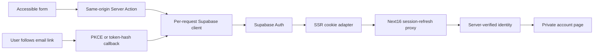
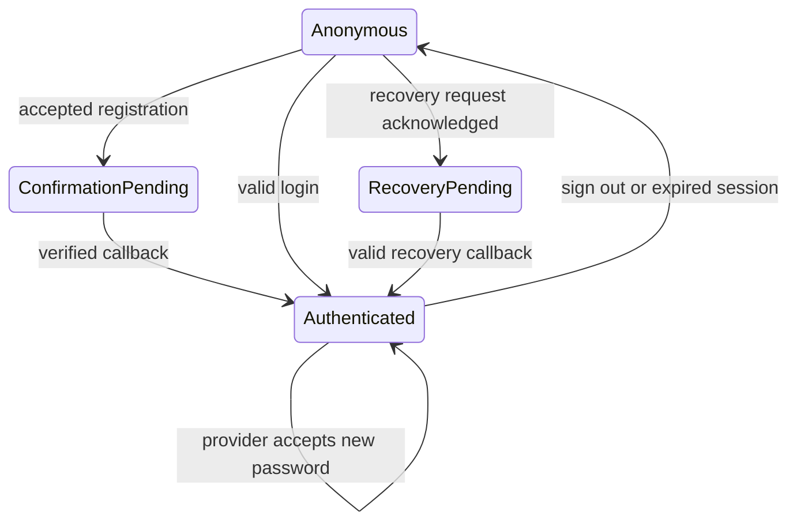

# CEPath Accounts and Authentication - Plan

## Goal Capsule

Objective: students can create, verify, recover and use a private CEPath account.
Means: Supabase email/password authentication with official cookie SSR integration (KTD1).
Authority: current M07 brief, AGENTS.md and CE-NAV-001. Implementation is authorized; commit, push, deployment and M08 are not. User will test email flows manually; never create accounts or send emails. Local implementation can be finished while live acceptance remains pending. Execution is native and sequential; this task owns local review and verification, with no shipping tail.

---
## Product Contract

### Summary

Add signup, login, email confirmation, recovery, password update and a minimal account page. Preserve existing public lessons and faculty bulletin navigation.

### Problem Frame

Students need a private identity for later learning continuity. The current platform offers educational content but no account/session infrastructure.

### Requirements

- R1: collect only email, password and confirmation where needed; validate on the server and announce errors accessibly.
- R2: distinguish registration accepted, confirmation pending, verified identity and authenticated session.
- R3: recover and update passwords through Supabase with safe expired/invalid-link handling.
- R4: verify identity on the server before revealing account information; anonymous visitors go to login.
- R5: refresh cookie sessions and invalidate local account access after sign-out; do not cache private responses publicly.
- R6: keep curriculum and published free lessons public, independently of accounts or prerequisites.
- R7: use safe internal redirects, keep privileged credentials out of the app, and never log tokens or passwords.
- R8: preserve responsive faculty bulletin forms, visible labels/focus, pending/disabled states and minimal navigation.
- R9: report real service integration separately from isolated/local tests; user reserves email testing.
- R10: no profiles/progress tables, social login, analytics, dashboards, marketing mail or future milestones.

### Acceptance examples

An anonymous learner reads Forces and Vectors but cannot open /account. A signed-in learner sees only their own server-verified email. A confirmation or recovery callback strips credential parameters before redirecting. Planned lessons remain unavailable rather than account-locked.

---
## Planning Contract

### Key Technical Decisions

- KTD1: use stable @supabase/supabase-js and @supabase/ssr compatible with Node24/Next16.4.0. Per-request server clients and proxy.ts follow current official guidance, including propagating refreshed cookies and cache headers. Browser client uses the same publishable configuration. Supabase owns password/token verification (R2–R7).
- KTD2: use Server Actions and a small testable action service; Next enforces same-origin action submission. GetClaims verifies header identity; getUser retrieves a fresh account record and authorizes password changes. Do not use getSession for authorization (R1,R4,R5).
- KTD3: preserve the existing ignored .env.local values and add placeholders only to .env.example. Pin a canonical APP_SITE_URL for email redirects, with a localhost development default and required HTTPS configuration in production. Reject privileged keys and untrusted return targets (R7).
- KTD4: allow only fixed /account, /update-password and /curriculum post-login destinations. Support PKCE auth-code exchange and documented token-hash confirmation templates; accept only email/signup and recovery verification types. Token-hash GET stages the credential in a short-lived HttpOnly cookie and redirects to /auth/verify; only an explicit same-origin Server Action consumes it. Callback responses have no-store/no-referrer, remove credential parameters and preserve session cookies. Suppress dev incoming callback URL logging (R2,R3,R7).
- KTD5: authenticate only account-specific operations. Proxy refresh never redirects public routes. The header receives server-verified state without exposing email; reading cookies in the shared layout makes pages request-rendered. Private/auth responses use no-store. This trades static HTML caching for consistent authenticated navigation in this small app (R4–R6,R8).
- KTD6: registration and recovery acknowledgements avoid account enumeration; provider errors map to sanitized messages. Password confirmation and required fields are local checks; provider-configured password requirements remain authoritative rather than imposing an invented minimum. Sign-out affects the current browser session (R1,R2,R3,R5).

### High-Level Technical Design

### Assumptions and external limits

Real local configuration is present and public Auth settings respond200: email enabled, signup allowed, automatic email confirmation disabled. Publishable credentials cannot inspect dashboard redirects, SMTP or the password policy. User performs real registration/email/recovery/session checks manually; these are not acceptance claims. No credential or project URL is recorded here. Dashboard settings and privacy/retention/age questions are documented before any public launch.

---
## Implementation Units

### U1. Configuration, identity and session boundary

**Requirements:** R4–R7. **Files:** .env.example, lib/supabase/{config,client,server,proxy}.ts, proxy.ts, lib/auth/identity.ts, tests/auth-policy.test.mjs.
**Approach:** implement KTD1–KTD3,KTD5 with fail-closed private pages and fail-safe public browsing.
**Test scenarios:** absent/placeholder/privileged config rejected; hostile external/protocol-relative/encoded return URLs rejected; request-scoped clients preserve cookies/cache headers; forged/missing sessions cannot authorize account access; no-configuration build still serves public lessons.
**Verification:** isolated policy tests and real HTTP protected/public behavior, strict types and dependency audit.

### U2. Authentication actions and callbacks

**Requirements:** R1–R5,R7,R9. **Files:** lib/auth/{policy,service,actions}.ts, app/auth/{confirm,callback}/route.ts, app/auth/verify/page.tsx, tests/auth-service.test.mjs, tests/auth-callback.test.mjs.
**Approach:** KTD2,KTD4,KTD6. Proof-first service tests inject a narrow provider seam without fabricating real integration success.
**Test scenarios:** invalid email/missing fields/mismatched password never call provider; registration pending differs from real returned session; login invalid/unconfirmed/rate-limit/network errors sanitized; recovery acknowledgment generic; token-hash GET never calls verification; explicit confirmation and valid PKCE code call the correct SDK method; expired/malformed links fail with no token echo; password update requires verified identity; sign-out failures retain truthful state.
**Verification:** targeted tests and actual Next route/action HTTP checks; user owns positive real-email acceptance.

### U3. Forms, account and navigation

**Requirements:** R1–R6,R8. **Files:** app/{signup,login,forgot-password,update-password,account}/page.tsx, components/auth/, components/layout/site-header.tsx, app/globals.css.
**Approach:** reusable focused form with visible labels, field errors, pending controls and a password-visibility button; shared shell and no public email. Minimal protected account is neither dashboard nor profile.
**Test scenarios:** keyboard submit/error announcement/password toggle/pending; anonymous account redirects; unauthorized password page has no form; available/free lesson links remain usable; current-user navigation and sign-out reflect verified state; no overflow at desktop/tablet/mobile/narrow widths.
**Verification:** bounded Impeccable screenshot/finish review and targeted browser/HTTP checks. Live signed-in flows remain explicitly pending.

### U4. Security review and documentation

**Requirements:** R7,R9,R10. **Files:** README.md, PRODUCT.md, DESIGN.md, .impeccable/design.json, docs/{ROADMAP,DECISIONS,AUTHENTICATION}.md.
**Approach:** targeted independent security/code review; precise dashboard/email-template/manual-test instructions; no speculative schema.
**Test scenarios:** no secrets tracked, no service-role use, no getSession-based authorization, cookies/redirects/private caches reviewed, previous lesson/data/math tests remain green, correct absent-service state.
**Verification:** lint/types/all focused tests/build, source and browser evidence, honest roadmap status.

---
## Verification Contract

Run npm run check and npm run build. Retain the14 existing curriculum/content tests; add bounded policy/service/callback tests. Use actual HTTP/browser requests to Next for missing/forged identity, redirect headers, callback failures and public lesson rendering. Check desktop, tablet, mobile,320px and actual user width in one batched round, one correction batch and at most one confirmation round. Required Impeccable independent finish review and documenter follow that evidence. Security review covers provider boundaries, CSRF, redirects, caching, cookie propagation, logging and secret handling. No real user or external email is created without a new explicit instruction.

## Definition of Done

U1–U4 local implementation and checks must pass. Milestone completion additionally requires user verification of real registration, confirmation, login, refresh persistence, account isolation, logout and password recovery; remain partially complete pending those checks. Documentation must state what ran, what used isolated provider doubles and what could not run. Leave existing services intact, stop any temporary verification server, and stop before M08 without commit/push/deploy.

## Execution record — 2026-10-14

U1–U3 are implemented and locally verified. U4 security review resolved the sign-out uncertainty finding; lint/types/26 focused tests, configured and missing-config builds, actual HTTP authorization/action checks and bounded guest/error browser checks passed. Impeccable finish review returned ship for its 19 captures, excluding positive live account/email UX. Final design documentation closes local implementation. Real registration, verification, login, refresh/expiry, user isolation, sign-out and recovery acceptance remain the Product Owner’s manual work; M07 stays In Progress. No commit, push, deployment or M08.
