# Persistent Lesson Progress

## Goal Capsule

Implement only M08: authenticated students explicitly start, complete, resume or reset a published lesson and retrieve private server-stored status. Existing public reading and CE-NAV-001 remain unconditional. No dashboard/M09, real-time/offline sync, analytics, new curriculum, commit, push or deployment. Preserve the uncommitted M07 implementation from this conversation. Native sequential implementation; no autonomous shipping.

## Product Contract

- R1: no row means Not Started; stored states are in_progress/completed. Reads never mutate progress. Revisit preserves completion; any explicit transition is allowed independently per lesson.
- R2: Supabase authenticated IDs own records; only server-verified identity selects a user. RLS and explicit grants independently protect each CRUD operation; ownership cannot be reassigned.
- R3: only known published lessons with actual registered MDX bodies may be mutated through CEPath application operations; stable IDs and route helpers remain authoritative. Planned entries retain publication labels and no controls.
- R4: reader controls show confirmed state, saving, retryable failure and expired/anonymous authentication honestly. Anonymous readers get a safe return-to-lesson login link, never a reading gate.
- R5: a module retrieves its relevant statuses in one query, without N+1 reads, public caching, fake progress or automatic completion of prior lessons.
- R6: migration is additive, reviewable and tested in isolation. Hosted/live application requires explicit approval; no privileged credentials, real accounts or email requests are introduced.
- R7: report isolated SQL/application checks separately from real Supabase/session/device acceptance. User reports development project and passing login/persistence/sign-out checks; email/recovery acceptance is not inferred.

## Planning Contract

### Key Technical Decisions

- KTD1 (R1,R2,R6): one public.lesson_progress table; composite (user_id,lesson_id) primary key, auth.users FK ON DELETE CASCADE, checked status and timestamptz fields. No duplicate user index, curriculum table or progress aggregates. Reset deletes the specific owned row. Database trigger owns timestamps: first start retained across status changes, completion timestamp cleared when returning in_progress, repeated identical status preserves timestamps, reset/restart begins a new record. Identity columns are immutable after insert.
- KTD2 (R2,R6): revoke inherited/default table access from PUBLIC, anon and authenticated; grant authenticated SELECT/INSERT/UPDATE/DELETE only. Four authenticated-only policies use (select auth.uid()) = user_id; UPDATE has USING and WITH CHECK. Ordinary SDK requests use user cookies/publishable key; no service-role bypass, SECURITY DEFINER mutation or RPC endpoint.
- KTD3 (R1–R5): reuse per-request Supabase server clients, fresh getUser verification and same-origin Server Actions. A small provider-independent progress service takes a narrow repository interface for focused tests; a server-only adapter performs scoped select/upsert/delete. Return saved rows, not optimistic desired state. Identity verification distinguishes unavailable/config/network failures from absent/expired sessions; each action uses a writable server client and fresh getUser on that same client. Failed reads are unavailable, never Not Started. Failed writes retain previous confirmed state and allow retry. Request-local React caching may deduplicate reads; no shared user cache. Revalidate lesson and module only after confirmed mutation.
- KTD4 (R3,R4): keep trusted MDX imports out of plain auth-policy tests. Add a small plain registered-lesson-ID export shared by the document registry and published-lesson lookup; published metadata without a registered body fails existing document tests. Extend the exact safe redirect allowlist with canonical registered published lesson paths; reject malformed/encoded/query/external variants. No arbitrary path prefix acceptance. RLS protects ownership, not repository publication: direct authenticated SDK requests can store arbitrary lesson IDs in their own rows; registry-scoped application reads ignore such rows. This intentional boundary is documented rather than duplicating curriculum metadata in SQL.
- KTD5 (R6,R7): no Docker/PostgreSQL/Supabase CLI or privileged management/database environment is available. Add pinned development-only @electric-sql/pglite to execute the actual migration with PostgreSQL roles/RLS/constraints in memory. Test-only auth.users/auth.uid fixtures substitute provider identity plumbing, explicitly not real Supabase JWT/email/HTTP integration. Keep hosted migration unapplied until review/approval and execution access are available.
- KTD6 (R4,R5): restrained ruled progress region in the existing lesson column, descriptive native buttons and text statuses; use inherited palette/type/focus. Client boundary contains controls only; MDX stays server-rendered. Module status labels appear only on published content for verified users, with unavailable feedback on read failure. No full sidebar, dashboard or progress percentage.

### Data flow

```mermaid
flowchart LR
  Reader[Public MDX reader] --> Controls[Explicit progress form]
  Controls --> Action[Server Action]
  Action --> Identity[Fresh verified user]
  Identity --> Registry[Published stable lesson lookup]
  Registry --> Store[Scoped Supabase adapter]
  Store --> RLS[PostgreSQL grants and RLS]
  RLS --> Row[One owned progress record]
  Row --> Confirmed[Confirmed status and revalidated module]
```

## Implementation Units

### U1 — Migration and ownership proof
Files: supabase/migrations/20261016000100_create_lesson_progress.sql, tests/progress-database.test.mjs, package.json/package-lock.json.
Test-first proof: migration absent before implementation; actual PostgreSQL tests cover all four own/cross-user operations, anonymous denial, owner reassignment, invalid status/completion timestamps, account-delete cascade, repeated upserts, independent lessons and idempotent reset. No remote schema mutation. Review SQL and migration plan before any hosted application.

### U2 — Verified service and curriculum integration
Files: lib/progress/{policy,service,store,actions}.ts, content/lesson-ids.ts, content/lesson-documents.ts, lib/auth/policy.ts; tests/progress-service.test.mjs, tests/auth-policy.test.mjs, tests/lesson-content.test.mjs.
Test-first proof for unknown/planned IDs, browser-supplied owner ignored, malformed status rejected, expired identity, read/write failure, confirmed returned state, reset when absent, idempotent updates and safe canonical lesson return paths. Adapter queries scope by verified owner and lesson IDs, no list N+1. Existing stable IDs and MDX remain intact.

### U3 — Reader controls, list states and final verification
Files: components/progress/{lesson-progress,progress-controls,progress-status}.tsx, components/lesson/lesson-reader.tsx, module route, app/globals.css; focused progress component rendering/browser checks.
Anonymous lesson is fully readable with login return link. Verified users see confirmed Not Started/In Progress/Completed; buttons cover start/complete/restart/reset, pending and retryable errors. Source tests/provider doubles do not imply real database saves. Isolated browser fixture, if required for authenticated UI coverage without a test account, must live outside shipping app/routes and be labeled fixture evidence; actual public route and anonymous denial also checked.

### U4 — Security review and living documentation
Files: docs/PROGRESS.md, docs/ROADMAP.md, docs/DECISIONS.md, README.md, PRODUCT.md, DESIGN.md, .impeccable/design.json and matching surface briefs.
Targeted independent plan/security review; bounded Impeccable desktop/mobile verification and finish/documenter handoffs. Record file changes, SQL deployment steps, privileges, timestamps, trust boundaries, migration approval and outstanding hosted acceptance. M08 is In Progress/blocked on hosted rollout if real critical database/persistence checks cannot run. Do not mark M07 email/recovery complete from the user's narrower report.

## Verification Contract

Run focused Node policy/service/database tests, lint, strict TypeScript and production build. Real PostgreSQL-engine tests execute actual migration and verify RLS as authenticated/anon roles; synthetic test-only UUIDs and auth claims never touch real students. Check public lesson, module, invalid/planned 404s, anonymous mutation denial, safe login return and no-store. Use one desktop/mobile/tablet visual inspection round and at most one correction confirmation round, one detector, scoped independent finish review and documentation. If real hosted migration/session/device testing is unavailable, explicitly report those checks blocked instead of passing them via mocks.

## Definition of Done

Local implementation requires U1–U4 and their observed checks. Full M08 acceptance additionally requires approved migration applied to the development project and real authenticated save/reload/logout/login/second-browser retrieval plus real hosted ownership isolation. No migration application permission is inferred from project classification alone. Do not begin M09. Keep the user's app and prior uncommitted work; no commits or shipping.

## Sources

Supabase RLS guide: https://supabase.com/docs/guides/database/postgres/row-level-security (accessed 2026-10-16; grants and policies protect separate boundaries). Supabase SSR guide: https://supabase.com/docs/guides/auth/server-side/creating-a-client (existing identity/cookie architecture). PGlite: https://pglite.dev/docs/ (isolated PostgreSQL test engine, not a hosted Supabase substitute).
